<div align="center">

# ui-skills-kit

**Claude skills for UI that doesn't look AI-generated.**
16 premium section layouts with reference wireframes, automatic section → layout mapping, anti-AI typography rules,
ready build recipes in CSS grid and three.js / React Three Fiber, plus Vercel's [find-skills](https://skills.sh/vercel-labs/skills) to discover more.

[](https://www.npmjs.com/package/ui-skills-kit)
[](LICENSE)
[](https://docs.claude.com/en/docs/claude-code/skills)

</div>

---

## Why

Ask an AI for a landing page and you usually get the same thing: centered headline, two buttons, gradient blob, Inter everywhere. This kit gives Claude a catalog of layouts taken from high-end design references, picks one for every section on its own, and enforces rules for turning them into **finished, production-grade sections**: real content, deliberate typography, accessible markup, a static fallback for every 3D effect and a proper mobile layout.

| Skill | What it does |
|---|---|
| `ui-layouts` | 16 layouts with wireframes, section → layout map, typography rules, CSS + R3F recipes |
| `find-skills` | Vercel's skill finder: ask *"is there a skill for…"* and Claude searches [skills.sh](https://skills.sh) |

## Install

**Globally**, available in every project (`~/.claude/skills`):

```bash
npx ui-skills-kit --global
```

**Into the current project** (`./.claude/skills`, commit it with your repo):

```bash
npx ui-skills-kit
```

Both install `ui-layouts` and then fetch the latest `find-skills` from [vercel-labs/skills](https://github.com/vercel-labs/skills). If find-skills is already installed, that step is skipped. Use `--no-find-skills` to skip it.

**As a dev dependency**, the skills are copied on every `npm install`, so the whole team stays on the same version (find-skills isn't fetched here, to keep installs offline):

```bash
npm i -D ui-skills-kit
```

**With the [skills CLI](https://github.com/vercel-labs/skills)** (also works for Cursor, Codex and other agents):

```bash
npx skills add bobcermak/ui-skills-kit
```

> **Update:** run the same command again (`npx ui-skills-kit@latest …`). The installer replaces the old copy.
>
> **Coming from `layouts-skill`?** The installer removes the old `.claude/skills/layouts-skill` folder automatically.
>
> **pnpm / bun** block install scripts by default, so use the `npx` variant there.

## Usage

Nothing to configure. Ask Claude for a hero, landing page, page section, portfolio or product page and the skill loads automatically.

Let it choose. Claude picks a layout for every section and tells you in one line:

> Build a landing page for our coffee roastery: hero, our beans, about us, newsletter.
>
> → Hero → L14 Product Spotlight · Beans → L15 Angular Bento · About → L02 Anchored Split · Newsletter → L12 Stepped Funnel

Or name a layout:

> Make the hero for the guesthouse site as **L09 Arch Frame**, with the 5 room photos as slides.

Claude reads your content (number of images, title length, CTAs…), picks the layout from the section map, checks the wireframe, and builds it. Page-level rules keep it varied: no layout repeats, at most one 3D section per page, and dense and airy sections alternate. Ask for options and it shows 2–3 candidates instead.

## Layouts

Every layout ships with a reference wireframe in `skills/ui-layouts/assets/layouts/`.

| ID | Preview | Name | Type | Best for |
|----|---------|------|------|----------|
| L01 | 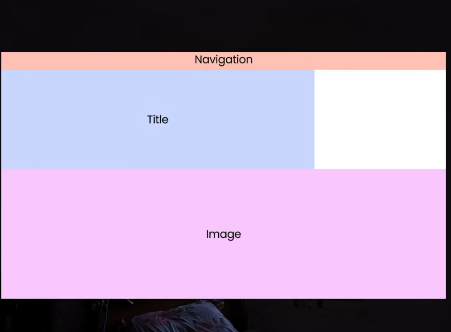 | Title Banner | CSS | Strong headline + one wide photo (restaurants, guesthouses) |
| L02 | 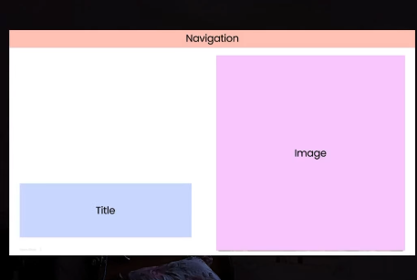 | Anchored Split | CSS | Editorial / portfolio, one tall portrait image |
| L03 | 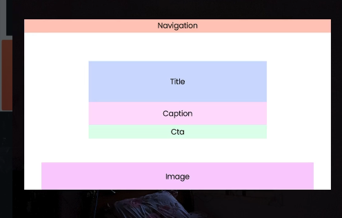 | Centered Showcase | CSS | SaaS / app — headline, CTA, product screenshot below |
| L04 | 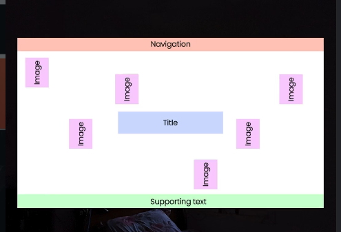 | Orbit Scatter | CSS / 3D-lite | Creative studio, many small images, playful |
| L05 | 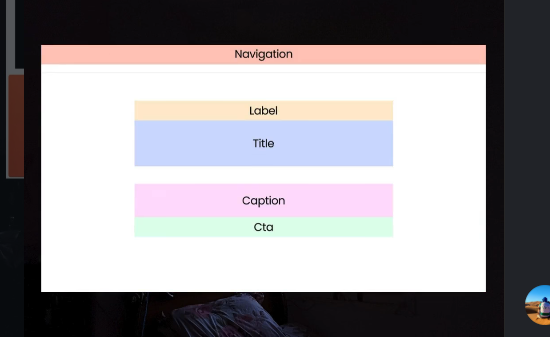 | Minimal Center | CSS | Text-led, agency, manifesto, no imagery |
| L06 | 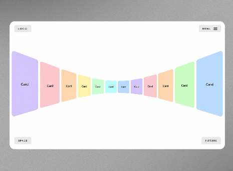 | Perspective Tunnel | **3D** | Gallery / portfolio with 8–14 items, "journey" feel |
| L07 | 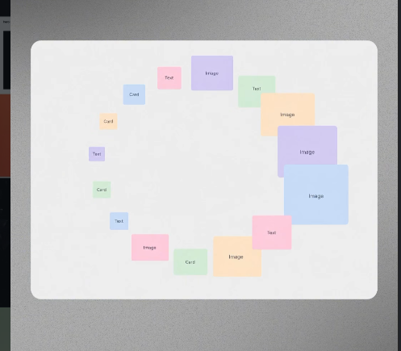 | Spiral Ring | **3D** / CSS | Collections, case studies, timeline of work |
| L08 | 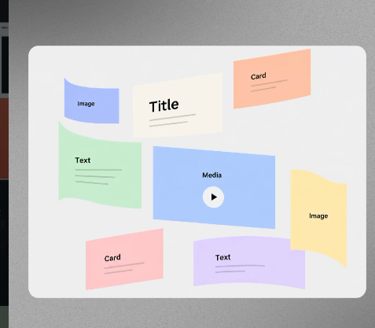 | Warped Collage | **3D** | Content-rich brand: media + text + cards floating |
| L09 | 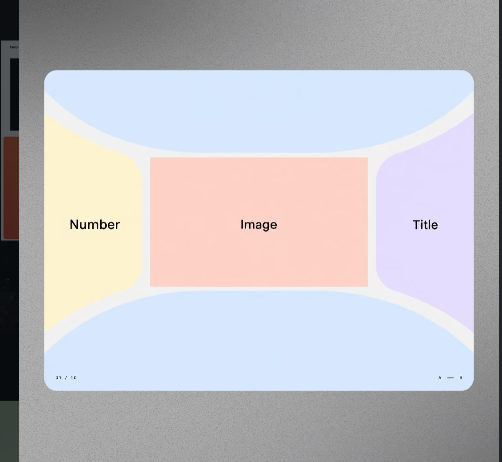 | Arch Frame | CSS (SVG mask) | Slideshow with index number + title, event, tour |
| L10 | 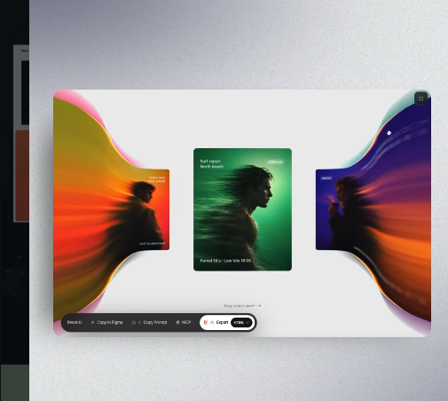 | Light Smear Carousel | **3D** shader | Fashion, music, posters — 3 hero visuals |
| L11 | 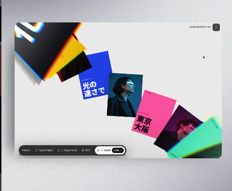 | Cascading Deck | **3D** | Archive / editorial, many posters, scroll-driven |
| L12 | 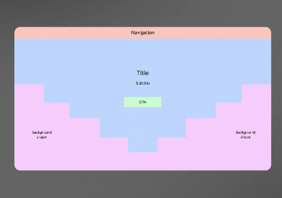 | Stepped Funnel | CSS (clip-path) | Bold launch page, single CTA |
| L13 | 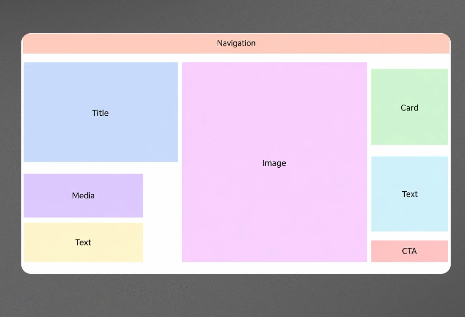 | Bento Triptych | CSS grid | Brand / product overview with many small modules |
| L14 | 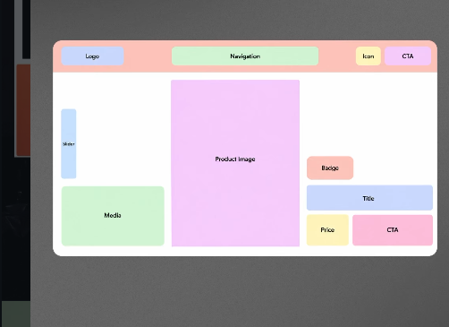 | Product Spotlight | CSS grid (+3D model) | E-shop product hero: image, badge, price, CTA |
| L15 | 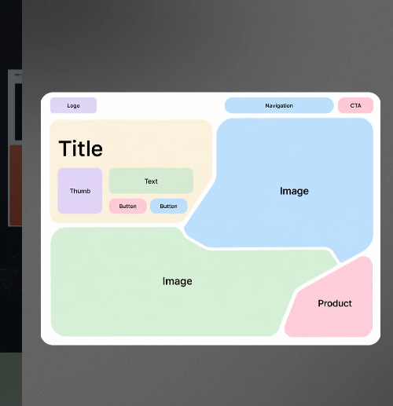 | Angular Bento | CSS clip-path | Premium product / outdoor / sport brand |
| L16 | 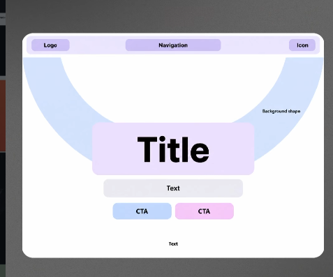 | Arc Halo | CSS / 3D-lite | Startup landing, huge title, two CTAs |

## Built-in rules

The skill makes Claude follow these on every build:

- **No wireframes** — placeholder regions are always filled with real content, typography and your brand palette.
- **Text stays in the DOM** — headings and CTAs are HTML (SEO, a11y); three.js renders only imagery and background.
- **3D is progressive enhancement** — `prefers-reduced-motion`, no WebGL or low-end mobile get a static composition.
- **One hero, one idea** — a single signature effect per section.
- **Section-aware** — layouts adapt to inner sections (no nav, `<h2>`, auto height), never repeat on a page.
- **Typography that isn't AI-default** — pairings by brand character, no Inter/Poppins/Montserrat headlines, no gradient text, tabular numbers, real quotes and non-breaking spaces (Czech-aware).
- **Mobile first-class** — every layout has its own collapse rule, checked at 375 px with no horizontal scroll.
- **Craft** — deliberate type scale, spacing, color and motion timing, even when the project has no brand yet.
- **Performance** — capped DPR, paused off-screen rendering, LCP image never blocked by the canvas.

## Stack

- **React / Next.js:** `@react-three/fiber`, `@react-three/drei`, optional `@react-three/postprocessing`
- **Vanilla:** `three` with the same math
- **Animation:** GSAP or Framer Motion for DOM, `useFrame` + damping for 3D, Lenis or drei `ScrollControls` for scroll

The skill only contains instructions — it adds no runtime dependencies to your project.

## What's inside

```
bin/install.js                    installer (skills + find-skills)
skills/ui-layouts/
├── SKILL.md                      rules, workflow, decision table
├── assets/layouts/               16 reference wireframes (L01–L16)
└── references/
    ├── layouts.md                all 16 layouts: regions, grid recipe, mobile rule
    ├── sections.md               section → layout map + page-level rules
    ├── typography.md             font pairings, scale, anti-AI checklist
    └── three-patterns.md         R3F code: tunnel, spiral, bend + smear shaders,
                                  cascade, parallax planes, product model
```

## Contributing

Ideas for new layouts or fixes are welcome — open an issue or a PR. New layouts should include a wireframe PNG, regions, a grid recipe, a mobile rule and a row in `sections.md`, following the format in `skills/ui-layouts/references/layouts.md`.

## License

[MIT](LICENSE) © Bob Čermák
